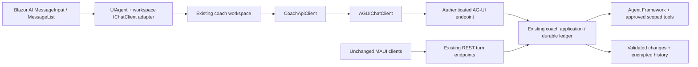

# AG-UI and Blazor AI in SentenceStudio

## Recommendation

Use AG-UI for the web coach's turn transport and the Blazor AI components for its conversation lifecycle, message list, and input. Keep SentenceStudio's application reducer, owned history, and protected write workflows authoritative. This is a useful interoperability and UI-composition improvement, not a reason to replace the application's safeguards or expose the raw model.

Live verification confirmed the integration, but exposed grounding/validation and language-quality issues in the coach. Treat this as a verified integration for a limited pilot, not a model-quality or broad-rollout sign-off.

The first migration is web-only. MAUI heads retain their existing REST turn client and shared UI defaults; no MAUI workloads are required to build or test the web migration.

## Existing AI implementation

The coach is built with Microsoft Agent Framework over `IChatClient`. Its baseline and harness implementations produce a typed `CoachTurnIntent` using approved, user-scoped tools. `CoachSessionService` validates that intent against grounding evidence, answer embargoes, constraints, ownership, budgets, and the current plan before returning learner-visible output or applying a change. Durable conversations add encrypted history, stable operation identities, idempotency, cancellation, and recovery.

That distinction matters: the model proposes; the application decides. A raw `MapAGUIServer` endpoint over the underlying model agent would expose a different boundary from the existing coach, potentially displaying structured model output or tool results before the application has validated them.

Other AI features are separate: typed gateway prompts and fast/reasoning chat clients support learning exercises and content generation; vision has its own validated route; speech uses ElevenLabs and an OpenAI fallback. These are not conversational agent transport and remain unchanged. The current LLM-named plan generator delegates to deterministic generation.

## What changed

The web sends turns to `POST /api/v1/coach/agent` using `AGUI.Client` 1.0.1. The API uses `AGUI.Abstractions` 1.0.1 for the SDK's event types and JSON resolver, and ASP.NET Core's `TypedResults.ServerSentEvents` for the response. It does not need the `AGUI.Server` raw-chat stream adapter because application validation must complete first. The request's thread ID locates an owned session or conversation; client messages and state never replace trusted server history. Client tool declarations and client-supplied results are rejected.

A run emits `RUN_STARTED`, a validated `STATE_SNAPSHOT`, assistant `TEXT_MESSAGE_*` events, and `RUN_FINISHED`, or `RUN_ERROR`. The snapshot carries the application's turn result and, for durable conversations, its operation handle. Original client turn IDs, operation IDs, and idempotency keys remain intact for recovery.

The web uses `Microsoft.AspNetCore.Components.AI` 0.1.0-preview.1.26466.103: `UIAgent`, `AgentContext`, `MessageList`, `MessageInput`, and a typed `BlockRenderer`. Its conversation thread projects the existing workspace rather than creating a second history writer. Application-specific answer, evidence, receipt, reporting, suggestion, memory, and approval cards remain custom typed content.

A thin web boundary owns and cascades the library's `AgentContext`. This preview's `RestoreAsync` does not clear error/retry state, and changing the library's `AgentBoundary` agent remounts its descendants. The adapter instead replaces the context and agent on thread changes or external recovery without remounting the application shell, and rebinds the input's status subscription. Incomplete or malformed AG-UI responses become handled transport failures so the workspace releases its busy state and retries retain the existing turn and operation identities.

Optional rendering slots in the shared transcript and composer keep the experimental dependencies out of native clients. Both hosts use the same domain timeline item component; the web projects it through a typed `RenderFragment` into the library's `BlockRenderer`. `EventCallback` and component parameters coordinate history restoration and rendering, rather than a separate event bus. Availability, conversation directories, history paging, approvals, undo, reports, and other resource operations still use their existing REST endpoints.

## Benefits and limitations

| Area | Benefit | Tradeoff |
| --- | --- | --- |
| Interoperability | Standard AG-UI events and an ordinary `IChatClient` client surface replace the web's bespoke turn protocol. | The state envelope remains application-specific; another client must understand the coach's domain to render its controls faithfully. |
| UI composition | Library conversation, input, and block-rendering primitives provide an extensible foundation for richer human-agent collaboration. | The workspace adapter, history projection, and synchronization are still necessary. This is not a net elimination of all custom code. |
| User control | Existing approvals, evidence, repair disclosures, receipts, reporting, and undo remain alongside the conversational foundation. | AG-UI approval interrupts and frontend tools are not enabled; introducing them requires integrating with the protected application operation flow. |
| Streaming | The transport supports run lifecycle and standardized SSE. | **Validated final output is buffered.** No model-token latency improvement is claimed: the reducer must finish before answer text can safely be shown. |
| History and retries | The same owned ledger and stable operation IDs work across the new web transport and old native transport. | This preview's message list snapshots turns at initialization. Canonical transcript replacement requires remounting the list, which can reset local disclosure or report-panel UI state; unrelated workspace notifications do not replace it. |
| Dependencies | Stable AG-UI packages can be adopted without upgrading the existing Agent Framework stack. | Blazor AI is experimental. Its API and styles may change, and integration must be rechecked on upgrades. Experimental warnings remain visible. |
| Composer UX | The library owns message submission and streaming-state interaction. | This preview exposes fewer input customization points than the original composer: draft binding, the localized counter, mobile Enter policy, and accessible button text do not have equivalent public parameters. Length enforcement remains in the adapter and API. |

Natural-language conversation remains a flexible, empowering foundation, while rich domain controls make the agent's proposals visible, contextual, reversible, and answerable. Future voice or vision interactions can build on that foundation; this migration does not add them. Predictive state, JSON Patch state deltas, frontend tool execution, reasoning display, and generative layout are also deliberately out of scope.

## Validation and local setup

Focused tests exercise the real authenticated API and reducer through the SDK in session-only and durable modes, including idempotent retries and invalid input. Client tests cover state snapshots, durable recovery handles, HTTP problem mapping, protocol run errors, and truncated streams. UI tests cover library retries, canonical-history projection, mounted input, synchronization, and the shared rendering and workspace behaviors retained by native clients.

Selected API, SDK transport, and UI/workspace/client regressions passed. Recovery tests use the actual shared transcript and composer slots and cover empty and populated conversation switches, deletion, external retry and dismissal, removal of stale error UI, subsequent submission, and retrying incomplete streams with unchanged operation identities. A broader rendering-test run also encountered existing fixture failures: several fixtures omit the `NavigationManager` required by `CoachVocabularySetCard`, which the transcript already rendered before this migration.

An isolated browser harness with real Identity cookies, PostgreSQL, and the API/reducer verified message submission, intentional repeated questions, visible history after refresh, response-report controls, and clearing the transcript when switching to a new conversation. Saved history and the input also rendered at a 390-pixel viewport without horizontal document overflow. The harness used a scripted model and test-server API clients, so it did not verify live inference or production API credential forwarding.

### Live-model verification

A subsequent browser check used the approved existing Foundry resource's `gpt-5-mini` deployment with `DefaultAzureCredential` restricted to the signed-in Azure CLI identity. Real local Kestrel web and API hosts exercised the unchanged cookie-to-JWT authentication handler, named HTTP clients, AG-UI endpoint, Agent Framework coach, reducer, and Blazor AI rendering. There were no scripted model responses or replacement coach transports. Web Identity used a disposable PostgreSQL database; the API used the existing test fixture's disposable SQLite databases. This verifies local HTTP authentication and inference, not deployed networking, managed identity, production PostgreSQL behavior, or restart-safe key storage.

Three learner turns made four successful inference HTTP requests:

| Case | Observed result |
| --- | --- |
| Polite Korean greeting | A structured answer rendered with explanation, examples, and a practice question. It remained visible after a full refresh. |
| Question about the empty saved vocabulary | The read-tool/model exchange completed, but the reducer rejected its result with `EvidenceWindow:window_length` / `ValidationFailed`. The UI showed a no-change notice; no learning-data change was applied. This needs follow-up in the existing grounding/validation flow. |
| Follow-up translation of 감사합니다 | A structured answer rendered successfully after the rejected turn. Its translation was correct, but it incorrectly described 감사합니다 as a "-요 form"; it is a formal polite 합니다 form. This is a model-quality finding, not an AG-UI rendering error. |

After another full refresh, all six messages and both answer cards were present and the input remained usable. These spot checks establish deployment access and working live integration, not reliable linguistic accuracy, broad grounded-answer coverage, or a latency benchmark. No new Azure resources or role assignments were created, and no existing learner data was used.

### Post-simplification recheck

Browser and live-model verification was repeated against commit `7418226e`, using fresh disposable databases and the same approved deployment, real local HTTP hosts, and production authentication forwarding. Seven persisted learner turns across two conversations made eight successful inference HTTP requests. All eleven AG-UI attempts carried bearer authentication; an unauthenticated API request returned 401.

| Case | Observed result |
| --- | --- |
| Submission, intentional repetition, and history | Identical greeting questions produced distinct turn identities and answers. Both conversations' direct links restored their saved history after full refreshes. |
| Incomplete SSE recovery | Two local response faults removed `RUN_FINISHED` after the real backend completed. Both the library's **Retry** and the workspace's **Try again** recovered the committed answer without another inference request or duplicate learner message. Thread, run, operation, idempotency, and client-turn identities were unchanged. |
| Cross-conversation error isolation | After an injected HTTP 503, creating a conversation cleared the error and retry controls. A new live turn succeeded. Switching between populated conversations restored only their canonical messages, without the abandoned question or a remounted application shell. |
| External dismissal | **Keep Today's Plan** cleared an injected HTTP error and stale retry controls. A subsequent live turn succeeded, and refresh restored the correct durable history. |
| Shared rendering and layout | Structured answers, report-panel opening/cancellation and focus restoration, and the composer worked. At 390 pixels, the transcript and input remained usable without horizontal document overflow. The final refreshed page had no browser console errors. |
| Coach grounding and language quality | The empty-vocabulary question again failed `EvidenceWindow:window_required` / `EvidenceWindow:window_length` validation without applying a learning-data change. This time the translation correctly identified 감사합니다 as formal polite 합니다, rather than a "-요 form"; the earlier model-quality finding is not thereby resolved. |

One transcript UX limitation remains: after dismissal, the abandoned local learner message stayed visible through the next successful turn, then disappeared on refresh. It was not saved in durable history and did not retain an actionable retry. The recheck did not establish whether that behavior predates the migration.

The HTTP failures and missing finish events were deliberate local harness injections, not provider failures. These checks do not exercise protected writes, approval/undo flows, native clients, or a deployed environment. The temporary hosts, databases, container, and generated sign-in artifacts were cleaned up afterward.

The local web build uses an already-installed .NET 11 RC3 SDK with `IncludeMobileTargets=false`; the API remains `net10.0`. A gitignored local SDK pin and session-only NuGet configuration accommodate this machine's installed reference packs and the repository's Mac-specific local feed path. The repository's `lib\coresync` feed is still required. Debug builds of the WebApp test host encountered an SDK-generated hot-reload module endpoint conflict; Release test builds avoid that Debug-only asset issue without changing production code or suppressing warnings.

No new Azure resource is required by AG-UI or Blazor AI. A live coach still needs the existing Foundry endpoint and model deployment configuration, an identity authorized for inference, the coach/cohort feature settings, and the application's databases. ElevenLabs is needed only for the separate speech features. The approved resource and Azure CLI identity were sufficient for the live checks; further model evaluation can reuse them without provisioning another resource.

## Sources

- [AG-UI .NET SDK announcement](https://devblogs.microsoft.com/dotnet/ag-ui-dotnet-sdk/)
- [Building agentic UI with Blazor](https://devblogs.microsoft.com/dotnet/build-agentic-ui-blazor/)
- Local reference implementation: `D:\GitHub\danroth27\AgenticUI`, particularly its AgentServer and Web scenarios.
- SentenceStudio implementation: `CoachSessionService`, the durable conversation service, `CoachAGUIEndpoints`, the web `Coach` adapters, and the shared coach transcript and composer.
